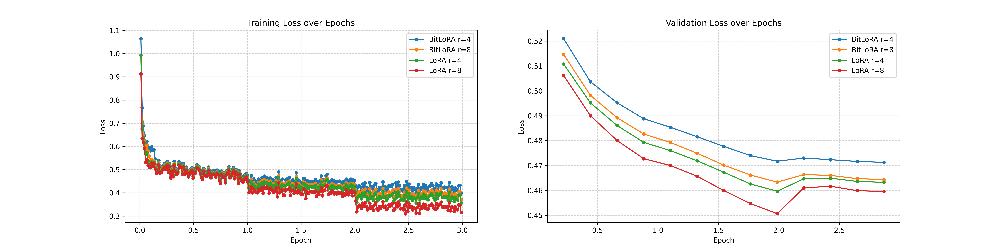

# python-BitLoRA-research

## Purpose
- LoRA(FP32) vs BitLoRA(1.58) tradeoffs
- Iso-memory evaluation (FP32 = 2bit[1.58 bit] * 16)) - 배포 기준

## Experiment

```
python ./train.py --adapter_type fp32 --r 8 --epochs 3 
```

## Performance Comparison

### Common Experimental Settings

**Environment & Data**

- **Language:** `python` 3.11+
- **Base Model:** `meta-llama/Llama-3.2-3B-Instruct`
- **Dataset:** `microsoft/orca-math-word-problems-200k` (Shuffle seed: 42)
  - Train Set: 14,500 samples
  - Validation Set: 500 samples
- **Hardware:** NVIDIA RTX 4060 Ti (8GB VRAM) (System RAM: 32GB)
- **Framework:** `peft` 0.18.1, `PyTorch` 2.10.0+cu128, `transformers` 4.52.0.dev0

**Training Hyperparameters**
- **Epochs:** 3
- **Max Sequence Length:** 512 tokens
- **Global Batch Size:** 16
- **Optimizer:** `paged_adamw_8bit`
- **Learning Rate:** 2e-4 (Cosine LR Scheduler)
- **LoRA Target Modules:** All linear layers (`q_proj`, `k_proj`, `v_proj`, `o_proj`, `gate_proj`, `up_proj`, `down_proj`)
- **LoRA Alpha:** `r * 2` (Dropout: 0.05, seed=42)

### Results



| Method | Trainable Params (%) | Validation loss (epoch=1.98) | PPL |GSM8K (CoT) | Adapter size (MB) | Inference energy consumption (pJ) |
| :--- | :---: | :---: | :---: | :---: | :---: |  :---: | 
| **BASE MODEL**            | --    | --    | -- | 76.88 | -- | -- |
| **FP32 Adapter (r=4)**    | 0.188 | 0.460 | -- | 74.75 | 23.2 | -- |
| **FP32 Adapter (r=8)**    | 0.377 | 0.451 | -- | 76.42 | 46.4 | -- |
| **FP32 Adapter (r=16)**   | 0.751 | 0.442 | -- | 73.24 | 92.7 | -- |
| **Ternary Adapter (r=4)** | 0.188 | 0.472 | -- | 76.12 | 1.45 | -- |
| **Ternary Adapter (r=8)** | 0.377 | 0.463 | -- | 76.35 | 2.89 | -- |
| **Ternary Adapter (r=16)**| 0.751 | 0.452 | -- | --    | 5.79 | -- |
| **Binary Adapter (r=4)**  | 0.188 | 0.471 | -- | 76.35 | 0.73 | -- |
| **Binary Adapter (r=8)**  | 0.377 | 0.462 | -- | 76.42 | 1.45 | -- |
| **Binary Adapter (r=16)** | 0.751 | 0.453 | -- | --    | 2.89 | -- |

- fp32: `adapter_model.safetensors`
- ternary(2bit packing): `ternary_model.bin`
- binary: `binary_model.bin`

#### GSM8K evaluation

```
python run_eval_batch.py --adapter_root to_eval --checkpoint checkpoint-1800   # base + all adapters, resumable
python src/eval.py --adapter_type ternary --adapter_path to_eval/ternary-r8/checkpoint-1800   # single run
```

- **Protocol:** GSM8K `test` (1,319 questions), 0-shot CoT, greedy decoding, `max_new_tokens=512`, batch size 8 (fixed for every run; padding changes results by ~±2%p)
- **Prompt:** Llama 3.2 chat template (`date_string` fixed to `26 Jul 2024`) + format instruction `Write the final numeric answer on the last line in the form "#### <number>".` appended to every question, for all models alike
- **Answer extraction:** first `#### N` → last `\boxed{N}` → last `answer is N` → last number in the generation
- **Checkpoint:** `checkpoint-1800` (step of the validation loss above). Raw training weights are loaded and ternary/binary LoRA weights are quantized in memory with the same `weight_quant158` / `weight_quant1` as the training forward. Adapters are not merged (merging into bf16 weights changed 26/48 generations in a check)
- **BASE MODEL:** re-measured with the same protocol (Meta reports 77.7 with 8-shot CoT)
- **Significance:** standard error ≈ ±1.2%p. Paired McNemar test vs base: only FP32 r=16 differs significantly (p=0.008); every other adapter is within noise (p > 0.1)
- Ternary r=16 / Binary r=16: `checkpoint-1800` not available locally yet
- Per-question generations: `eval_results/<run>.jsonl` (not committed), run summaries: `eval_results/summary.jsonl`
- Runtime on RTX 4060 Ti: base ≈ 36 min, adapters ≈ 56–87 min each

### Issues
- ~~`activation` 양자화를 제외하고도 학습시켜봤으나 성능차이가 없거나 미비함 (정수 연산을 위해 W1A8 선정)~~
- `unsloth`를 이용해서 학습을 가속하려고 했으나, `BitLinear`가 적용되지 않는 문제가 발생
- `activation quant` 제거
- `binary` adapter 추가